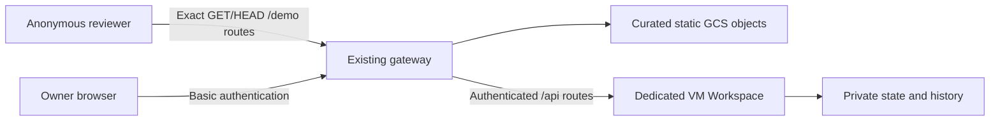
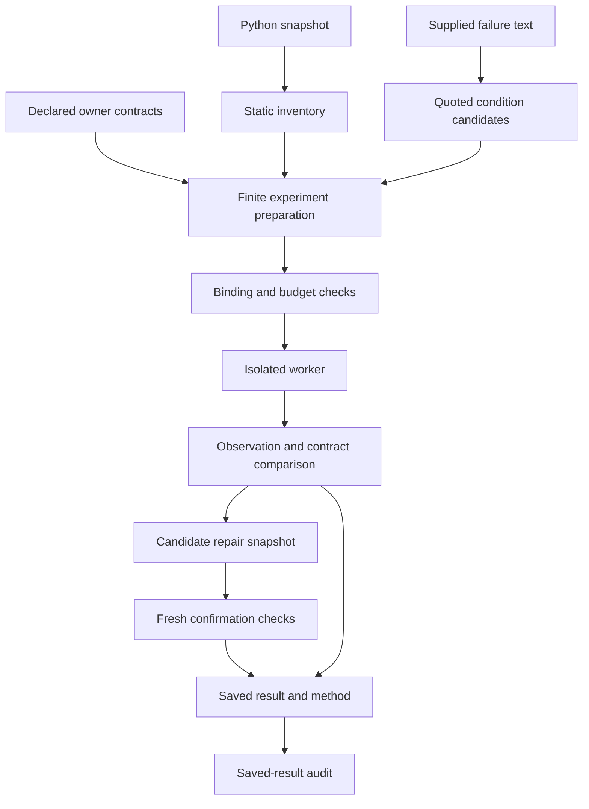
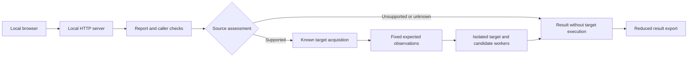

# Architecture

The public package runs as a local Python application with isolated child
workers and a file-based result store. This page describes implemented
interfaces. The broader incident-knowledge workflow is listed separately in
[Public scope](minimal-implementation-plan.md).

The hosted owner application also runs on the dedicated GCP VM through the
existing gateway. Its current Web policy is `OFFLINE_RECORDS_ONLY`: the worker
capabilities described below are not permission to start new browser experiments.
The [latest delivery](current-delivery.md) and its
[checkpoint](../publication/read-only-delivery-20261015.json) identify public main
`dffb8f7` and the observed read-only branch below, including successful Actions
and Cloudflare browser checks. The [earlier checkpoint](../publication/ci-delivery-20261015.json)
is retained separately. [Historical Vertex AI use](historical-vertex-ai-usage.md)
is a distinct inference record, not an inference performed by this public UI.

## Public viewing and owner access

The static branch does not instantiate the Workspace and cannot proxy its API.
Only fixed publication paths are anonymous. Other owner routes keep their
authentication, origin checks and server-side execution rejection. See
[Read-only review](read-only-demo.md) for the allowlist and offline export.

## IR review and experiment authority

Incident replay rebuilds a candidate IR and review questions from frozen Source
and saved provider exchanges. System replay uses the supported captured
evidence-lineage adapter and its archived System IR witness. JEV answers assess
source fidelity; neither these answers nor a model repair proposal authorize
Target execution. The exact-byte replay and deterministic validation paths
are documented in [Incident reproduction](incident-reproduction.md) and
[System IR reproduction](system-ir-reproduction.md).

Actual experiments require a separately supported caller, existing specification,
fixed Target identity, human authorization, isolation and available durable
budget. Observation/contract comparison then controls finite candidate adoption.
No arbitrary repository-to-IR inference, automatic production repair, calibrated
probability or additional Source benefit is established by this diagram.

## Repository experiment path

The caller supplies the target and owner requirements. Static inspection does
not import the target. Only supported bindings proceed to the finite workers.
Source conditions may influence exploration; they do not grant execution
authority or redefine the contract.

The repair loop stores candidate files in its result. It checks the input
snapshot after execution and does not write those files into the checkout.
The paired path runs separate Source and No Source loops serially, with
separate candidate and reuse histories.

## Local demo path

The demo recognizes two finite caller shapes and two known target controls.
Its baseline and recorded modes work without live model calls. An optional
cloud adapter can assess text or propose a bounded caller repair when explicitly
configured. Generated code must satisfy the candidate grammar before it is
passed to the corresponding worker.

## Portable evaluation

`reqlox study` connects local preparation, equal-budget exploration, and
calibration diagnostics through [`reqlox/studies.py`](../reqlox/studies.py).
[`capsule.py`](../reqlox/capsule.py) checks supplied wheel identities and a
finite dependency closure without installation. The context protocol uses
author documentation and signatures to bind a caller. Condition programs reach
the isolated worker without exposing the Source payload to the No Source arm.
Calibration registration freezes an unlabeled confirmation input and a single
candidate; public row inputs retain a provenance hold and cannot activate it.

See [Portable evaluation](portable-evaluation.md) for commands and limits.

The `/study` browser workspace reuses the reproduction server, origin checks,
request token, execution lock, and visual components. Its adapter in
[`study_ui.py`](../reqlox_demo/study_ui.py) calls the existing preparation,
comparison, and scoring interfaces. Static stages produce private artifacts;
a comparison runs in a bounded background job and returns aggregate status.
The browser serves no detailed journal or arbitrary local file.

## Component map

The `/knowledge` workspace and `reqlox knowledge` CLI share
[`reqlox/knowledge.py`](../reqlox/knowledge.py). The namespaced package keeps the
current document reader, SQLite FTS5 and hashing-vector search, native IR
fidelity and atomicity routing, optional provider adapters, and partial scores.
Immutable private plans bind method hashes and quotations. Independent judge
batches can run concurrently under one durable reservation ledger; generation
must finish before its candidate can be reviewed. PostgreSQL and pgvector are
provided as reference DDL, with no runtime connection in this package.
See [Local incident knowledge](local-knowledge.md) for commands and boundaries.

| Responsibility | Entry points |
| --- | --- |
| Public API and CLI | [`reqlox/__init__.py`](../reqlox/__init__.py), [`reqlox/cli.py`](../reqlox/cli.py) |
| Document search and native IR | [`reqlox/knowledge.py`](../reqlox/knowledge.py), [`reqlox_knowledge`](../reqlox_knowledge) |
| Snapshot loading and run records | [`run_reliability_reuse.py`](../reqlox_core/run_reliability_reuse.py) |
| Inventory and finite binding | [`reliability_reuse.py`](../reqlox_core/reliability_reuse.py) and related binding modules |
| Condition and requirement preparation | [`prepare_reliability_reuse.py`](../reqlox_core/prepare_reliability_reuse.py), [`reliability_specifications.py`](../reqlox_core/reliability_specifications.py) |
| Repair loop and paired study | [`run_reliability_improvement_loop.py`](../reqlox_core/run_reliability_improvement_loop.py), [`run_reliability_paired.py`](../reqlox_core/run_reliability_paired.py) |
| Saved-result audit | [`audit_reliability_reuse.py`](../reqlox_core/audit_reliability_reuse.py) |
| State directory | [`reqlox_paths.py`](../reqlox_core/reqlox_paths.py) |
| Demo API and engine | [`server.py`](../reqlox_demo/server.py), [`engine.py`](../reqlox_demo/engine.py) |
| Demo isolation and worker plans | [`isolation.py`](../reqlox_demo/isolation.py), worker modules |
| Optional model transport and ledger | [`cloud_model.py`](../reqlox_demo/cloud_model.py) |
| Effort and discovery records | [`workflow_effort.py`](../reqlox_core/workflow_effort.py), discovery metrics modules |

## Execution boundaries

Workers receive selected plans and read-only inputs. Isolation uses user,
mount, PID, and network namespaces. The demo acquires pinned distributions
outside the isolated execution step; worker network isolation does not describe
the acquisition step.

The browser server listens on loopback and checks its local origin and request
token. This is the local demo interface, not an externally exposed multi-user
service. Repository experiments and the demo share some qualification modules
but have different plan and result formats.

Saved results bind inputs, selected methods, runtime identity, and observations.
An audit checks those records without running the target again. Reused
observations remain historical observations.

See [Data contracts](data-contracts.md) for artifact formats and
[Safety and data](safety-and-data-policy.md) for operational limits.
