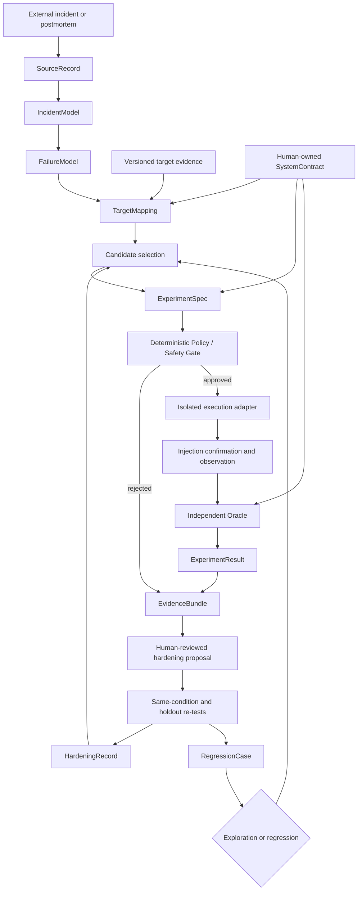

# Architecture

## Status and evidence labels

This document defines the proposed architecture for the working concept
**Incident-Derived Resilience Hardening Framework**. It is a design, not an
implemented or validated system.

Statements use these meanings:

- **Decision:** a boundary accepted for the initial design.
- **Hypothesis:** a proposition that requires evaluation.
- **Open question:** an intentionally deferred choice.
- **Illustrative example:** a hypothetical, unexecuted scenario.
- **Non-goal:** work intentionally outside the current scope.

## Problems and design objective

The framework addresses discovery and reuse. Free-form reasoning and generic
fault catalogues do not necessarily explore the combinations of timing,
resources, dependencies, and recovery behavior that exist in a target. At the
same time, reinterpreting the same evidence and rebuilding target context for
every investigation may be expensive.

The objective is therefore to transform external operational failure knowledge
into evidence-linked, target-specific experiments and verified regression
assets, while recording enough identity and invalidation information to avoid
unsafe or stale reuse.

The design does not assume that repeated reading of source material is the only
cost driver. Long searches, tool calls, patch-and-test iterations, experimental
infrastructure, verification, context reconstruction, and human review are also
candidate causes to be measured.

## Architectural decisions

1. Source statements and project inferences remain distinguishable.
2. A failure model records mechanisms and preconditions, not only a category.
3. Every target mapping is bound to target evidence and can end as
   `APPLICABLE`, `NOT_APPLICABLE`, or `INSUFFICIENT_INFORMATION`.
4. A human-controlled `SystemContract` is an independent input.
5. AI output remains proposal-level information.
6. A deterministic policy gate alone decides whether a structured experiment is
   admissible within already granted authority.
7. Experiment execution, injection validity, target verdict, and problem
   attribution are separate result dimensions.
8. An independent oracle evaluates the frozen contract from collected evidence;
   the proposal generator cannot relax its own scoring rules.
9. Exploration and regression have separate selection objectives.
10. A hardening result becomes reusable only after same-condition and holdout
    checks are recorded with scope and limitations.
11. v0.x should be one CLI/library process with local artifacts. These logical
    responsibilities do not require separate services, databases, or repos.
12. Production execution is not an initial capability or implied future right.

## Data flow



The local artifact store is omitted from the arrows for readability. Every
named model, decision, specification, and result is persisted there with
references to its inputs. Storage is a logical responsibility; v0.x can use
ordinary files and does not require a database.

## Component responsibilities

### Source handling

Records source identity, publisher, version, acquisition time and status, and
allowed retention and disclosure scopes. It treats all external prose, source
code, and logs as untrusted data rather than operational instructions. It does
not assert that publicly accessible content is freely redistributable.

### Incident interpretation

Builds an `IncidentModel` containing what the source reports: symptoms,
timeline, environment, reported cause, mitigations, unresolved questions, and
citations into the permitted source representation. A reported cause is not
promoted into a cause independently verified by this project.

### Failure abstraction

Builds a `FailureModel` that retains enabling conditions, trigger, mechanism,
propagation, finite resources, expected observations, exclusions, and
uncertainty. It may remove vendor-specific details only when the evidence still
supports the resulting abstraction.

### Target analysis and mapping

Relates a failure mechanism to a versioned snapshot of target code,
configuration, dependencies, permissions, topology, and test coverage. Each
`TargetMapping` states which conditions were confirmed, which remain unknown,
and why the mechanism is applicable, not applicable, or cannot yet be judged.
Non-applicable incidents are valid outcomes, not pressure to invent an
experiment.

### Candidate selection

Selects from applicable mappings according to target relevance, untested scope,
similarity to existing candidates, risk, and execution cost. Exact weights and
optimization algorithms remain open until evaluation data exists. Candidate
generation remains bounded by budget and does not attempt unrestrained
combinatorial search.

### Specification and deterministic policy

`ExperimentSpec` freezes target identity, inputs, injection, load, duration,
limits, injection-confirmation method, observations, oracle, cleanup, budget,
and referenced versions. Immediately before execution, the gate rechecks target
identity, prerequisites, current authority, protected resources, and limits.

An old or previously approved specification is not automatically safe. A policy
decision is bound to the current inputs and execution context and is invalidated
when those inputs change.

### Execution and observation

An adapter invokes one selected, existing fault-injection backend in an isolated
environment. It records whether the requested action started, whether the
intended fault condition actually became true, whether required observations
were collected, whether stop/cleanup completed, and what residual state remains.
Provider success alone is not target recovery.

### Independent oracle

The oracle evaluates a frozen `SystemContract` using declared evidence. The
experiment generator and patch proposer cannot change invariants, load,
observations, or thresholds in order to produce a favorable verdict. Contract or
oracle changes are reviewed and versioned separately from target changes.

### Evidence, hardening, and retention

`EvidenceBundle` links immutable or integrity-addressed copies/references of the
plan, policy decision, execution events, observations, oracle inputs and output,
cleanup evidence, and unresolved gaps. AI may propose a hardening change, but a
human reviews it before application to an isolated target.

`HardeningRecord` records the change and before/after evidence. A
`RegressionCase` is retained only with an executable scope, same-condition
re-test, and limitations. Passing only the exact condition used to design the
fix does not establish generalization.

## Human-owned `SystemContract`

The contract defines at minimum:

- protected functions and invariants;
- permitted degradation and required recovery;
- target identity and blast-radius boundary;
- permitted and prohibited operations;
- observation and verdict prerequisites;
- experiment budget, concurrency, and stop conditions; and
- ownership, approval, freeze point, and change-review rules.

Changing a contract can change what counts as success without changing target
behavior. It therefore creates a new evaluation lineage and triggers review of
dependent mappings, specifications, oracles, and regression cases.

## AI and authority boundary

AI may propose:

- incident interpretation and reusable failure mechanisms;
- target mappings and candidate rankings;
- structured experiments within a supplied contract;
- hardening changes; and
- evidence-linked explanations and uncertainty.

AI output alone must not:

- authorize execution or select targets outside an allowlist;
- turn instructions embedded in external material into tool calls;
- set or expand blast radius, intensity, duration, or concurrency beyond policy;
- mutate protected resources or production;
- enforce cleanup, claim rollback, or grant additional authority;
- change a contract or oracle as part of a target patch; or
- convert missing evidence, a failed injection, or harness success into target
  `PASS`.

## Exploration and regression

### Exploration

Exploration searches for conditions not covered by the frozen baseline test set.
It may vary parameters, operation order, dependencies, finite resources, and
bounded compound failures. Incident-derived knowledge is one source of
candidates, alongside ordinary tests, design review, generic chaos techniques,
and property-based approaches.

### Regression

Regression re-runs a known weakness and its verified fix under frozen,
version-compatible conditions. A regression result can detect recurrence but
does not by itself show that a fix works under a different condition or target.

Holdout experiments and cross-target mappings are therefore recorded separately
from exact regression replays.

## Multidimensional result model

A single `PASS` / `FAIL` / `INCONCLUSIVE` value cannot represent execution and
target behavior accurately. `ExperimentResult` records at least:

| Dimension | Candidate states |
| --- | --- |
| Execution | `NOT_RUN`, `REJECTED`, `RUNNING`, `STOPPED`, `COMPLETED`, `EXECUTION_ERROR` |
| Experiment validity | `VALID`, `INVALID_PRECONDITION`, `INJECTION_NOT_ESTABLISHED`, `OBSERVATION_INCOMPLETE`, `UNKNOWN` |
| Target verdict | `CONTRACT_MET`, `CONTRACT_VIOLATED`, `EVIDENCE_INSUFFICIENT`, `NOT_EVALUATED` |
| Problem attribution | `TARGET`, `HARNESS`, `INFRASTRUCTURE`, `MIXED`, `UNKNOWN`, `NONE_OBSERVED` |

Consequences include:

- failed injection is not target success;
- harness failure is not target failure;
- missing observation is not normal behavior;
- clean harness exit is not proof of target recovery; and
- a target verdict is issued only when the experiment was valid and its required
  evidence was available.

The evidence also distinguishes these claims:

1. symptoms resembled an external incident;
2. the hypothesized failure mechanism occurred in this target;
3. a target weakness was confirmed under those conditions;
4. the weakness improved after a target change; and
5. the external incident's original cause was independently established.

The ordinary experiment loop may support claims 2–4. It does not automatically
support claim 5.

## Reproducibility boundary

Freezing an `ExperimentSpec` improves traceability but does not make distributed
or concurrent behavior perfectly reproducible. The result records all
controllable parameters, observable environment identity, timing, model and
harness versions, and available random seeds. Unavailable model internals or
seeds remain explicitly unavailable. Multiple trials are used where outcomes
are probabilistic, and variation is reported rather than hidden.

## Illustrative examples

These examples are hypothetical and unexecuted. They are not confirmed defects
in any stream or other real system.

### Retry amplification exhausts a finite pool

An external report suggests the mechanism:

```text
dependency latency → overlapping retries → worker/connection retention
                   → finite pool exhaustion → cascading timeout
```

A mapping is `APPLICABLE` only if target evidence confirms a bounded pool, retry
behavior that can overlap, and delayed release. It is `NOT_APPLICABLE` if retries
are absent or strictly serialized within the proven load boundary, and
`INSUFFICIENT_INFORMATION` if pool or retry behavior cannot be established.

An isolated experiment would introduce bounded dependency latency under a fixed
load, verify both the latency and retry amplification, observe pool occupancy,
queueing, errors, protected functions, and recovery, and abort before the
contract limit. A possible hardening proposal is retry budgeting, backoff, or
resource isolation. Re-test uses the original condition plus a holdout condition
with different latency timing or load. No result is claimed here.

### Lost response after a committed side effect

The hypothetical mechanism is:

```text
side effect committed → response lost → caller retries
                      → duplicate side effect
```

Applicability requires evidence of a retrying caller, a non-read operation, and
an ambiguity window between commit and acknowledgment. Mapping should inspect
idempotency keys, durable outcome records, deduplication scope, and the caller's
confirmation path rather than assume them.

An isolated adapter would cause response loss only after confirming the test
side effect, then observe durable records and externally visible effect count.
The oracle would require exactly one effect and a conclusive caller outcome. A
candidate improvement could combine durable idempotency with status lookup. A
holdout re-test would vary the loss timing or process restart boundary. This is
also an unexecuted teaching example.

## Deployment form and open decisions

For v0.x, the preferred form is one local CLI/library process, one artifact tree,
serial execution, one isolated target, and one existing injection backend.
Independent services, distributed locks, vector databases, multi-agent voting,
multi-cloud support, and a management UI are not initial requirements.

Open decisions are recorded in the
[minimal implementation plan](minimal-implementation-plan.md), including the
first target, injection backend, artifact serialization, oracle implementation,
and criteria for any later production discussion.

## Relationship to other systems

OES remains independent and is not needed to execute an experiment, judge it, or
store evidence. A future evidence-format adapter is possible, without importing
OES code or changing either project's licensing.

Existing fault-injection tools should be used behind a narrow adapter when they
meet the selected experiment's needs. The framework's intended contribution is
the provenance-to-mechanism-to-mapping-to-evidence loop, not reimplementation of
every injector.

## Non-goals

- exhaustive coverage of global incidents or the target's unknown failure set;
- complete reproduction of an external organization's environment;
- endless replay of one known failure;
- unrestricted AI or production authority;
- a single score that guarantees whole-system resilience;
- initial support for every cloud, operating system, or injector;
- integration or relicensing of OES; and
- feature count or document count as measures of project success.
